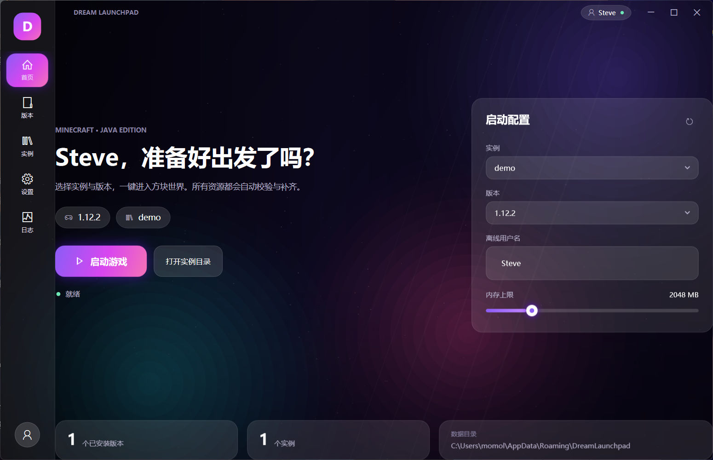
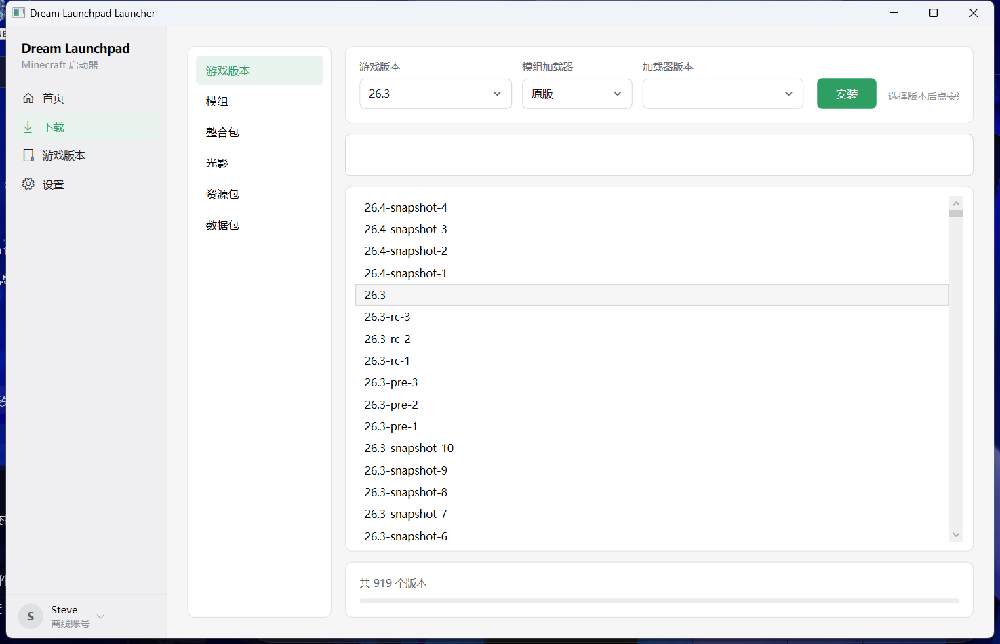
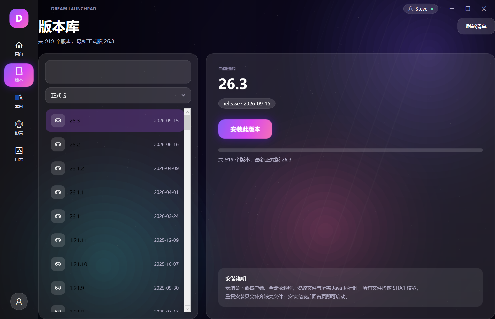
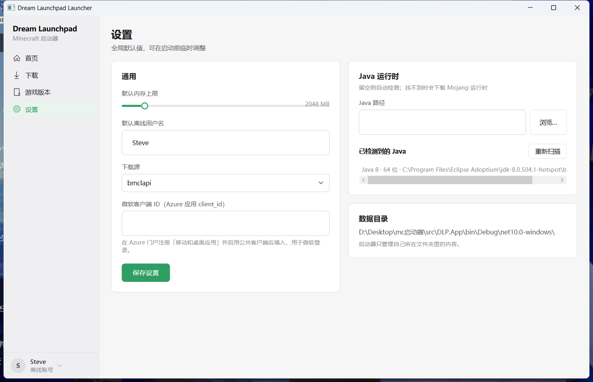

# Dream Launchpad Launcher

从零设计的 Minecraft: Java Edition 启动器（代号 **DLP**）。整个启动器就是一个文件夹，所有数据都放在 exe 旁边。

## 版本与加载器

- 支持 Mojang 官方清单里的全部版本（含 1.13+ 新参数格式、快照与远古版本）。
- 加载器：Fabric / Quilt / Forge / NeoForge，安装后与对应的原版版本一起显示、可独立启动。
- Java 运行时按版本要求自动下载（1.20.1 用 Java 17，1.12.2 用 Java 8），也可在设置里指定本机 Java。
- 下载走 BMCLAPI 镜像，镜像 SSL 失败时自动回退官方地址。
- 下载页打开即显示热门内容（按下载量），输入关键词再精确搜索。
- 整合包支持 Modrinth `.mrpack` 一键安装（自动装原版 + 加载器 + 内容 + 覆盖配置），也可以把 .mrpack / .zip 直接拖进窗口安装。
- 加载器下拉按游戏版本过滤：Fabric/Quilt 需要 1.14+，NeoForge 需要 1.20.1+，低版本只列 Forge。
- 微软登录走设备码：自动开系统浏览器、验证码自动复制。内置了发布者注册的公共客户端（`9c8a21d5-5f66-4dba-b90a-42e47d2aaac1`），用户不用填任何 ID；要换成自己的见 [docs/微软登录-客户端ID申请步骤.md](docs/微软登录-客户端ID申请步骤.md)。

## 功能

- **首页**：当前账号、启动版本、内存上限（平滑滑杆）、启动按钮与状态、版本隔离目录
- **下载**：游戏版本（原版 + Fabric / Quilt / Forge / NeoForge 加载器）、模组、整合包、光影、资源包、数据包
- **游戏版本**：已安装版本列表、版本目录与隔离游戏目录、打开目录、删除版本
- **设置**：内存上限、下载源（BMCLAPI / 官方）、微软客户端 ID、Java 路径与扫描
- **账号**：左下角切换账号；微软账号登录（OAuth 2.0 设备码，令牌加密保存在本地）
- **版本隔离**：每个版本使用独立的 `versions/<id>/game` 目录，mods、存档、配置互不影响
- **镜像**：下载默认走 BMCLAPI（`https://bmclapi2.bangbang93.com`），可在设置里切回官方源

## 界面预览

扁平浅色界面：左侧导航、内容区卡片，1px 分隔线、8px 圆角、绿色强调色，无渐变与玻璃效果。

## 构建与运行

需要 .NET 10 SDK（界面）或 .NET 10 Desktop Runtime（仅运行）。

~~~bash
dotnet build
dotnet run --project src/DLP.App          # 启动界面
dotnet publish src/DLP.App -c Release -o dist/DLP.App
~~~

命令行：

~~~bash
dotnet run --project src/DLP.Cli -- versions
dotnet run --project src/DLP.Cli -- install 1.12.2
dotnet run --project src/DLP.Cli -- run 1.12.2 --username Steve --memory 2048
~~~

## 结构

~~~
DreamLaunchpad.slnx
├─ src/DLP.Core    核心库（清单、下载、安装、加载器、Java、认证、启动）
├─ src/DLP.Cli     命令行
├─ src/DLP.App     界面
└─ tests/DLP.Core.Tests
~~~

## 数据目录

便携模式：启动器只管理自己所在的文件夹。

| 路径 | 内容 |
| --- | --- |
| `versions/` | 版本 json / jar；每个版本的隔离目录 `game/` |
| `libraries/`、`assets/` | 依赖库与资源（BMCLAPI 镜像） |
| `runtime/` | 自动下载的 Mojang Java 运行时 |
| `accounts.json` + `accounts.key` | 账号列表；令牌 AES-GCM 加密，密钥仅当前用户可读 |
| `config.json` | 启动器设置 |
| `logs/` | 启动器日志（界面不提供日志页） |

## 微软登录

在 [Azure 门户](https://portal.azure.com) 注册「移动和桌面应用」，启用公共客户端流，把 client_id 填到设置页，然后在左下角「切换账号 → 添加微软账号」按提示输入设备码即可。未配置 client_id 时登录会提示「未配置微软客户端 ID」。

## 文档

- [设计文档](docs/设计-Dream-Launchpad-Launcher.md)
- [PCL / PCL-CE 参考调研](docs/PCL-参考仓库调研.md)
