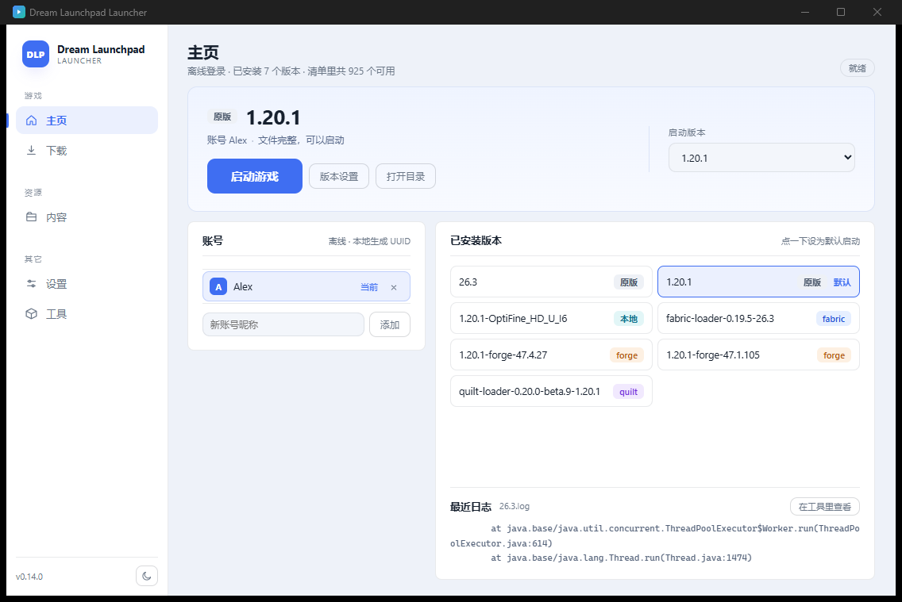
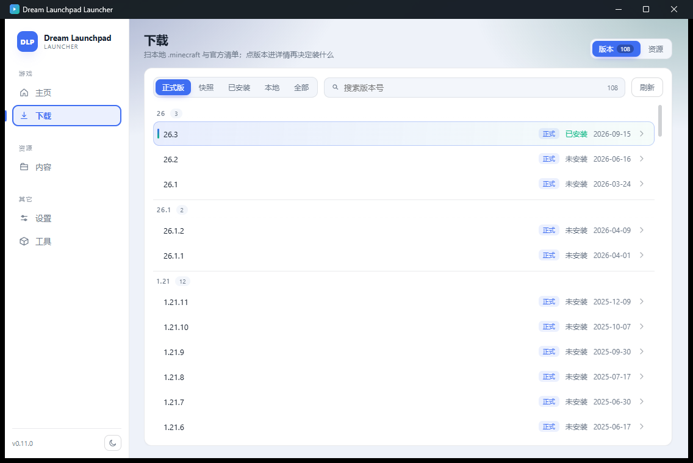
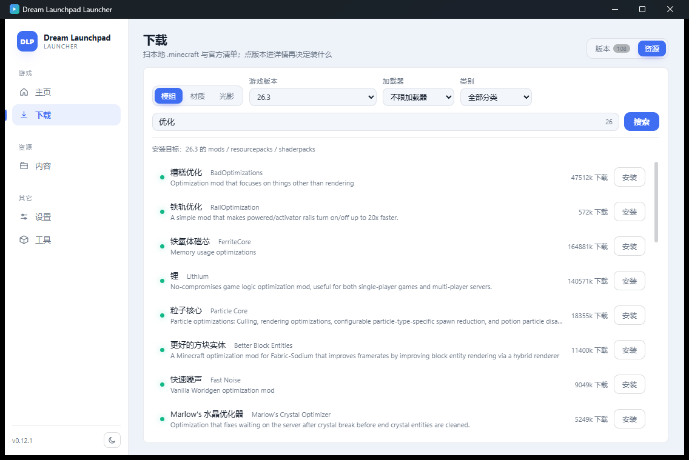
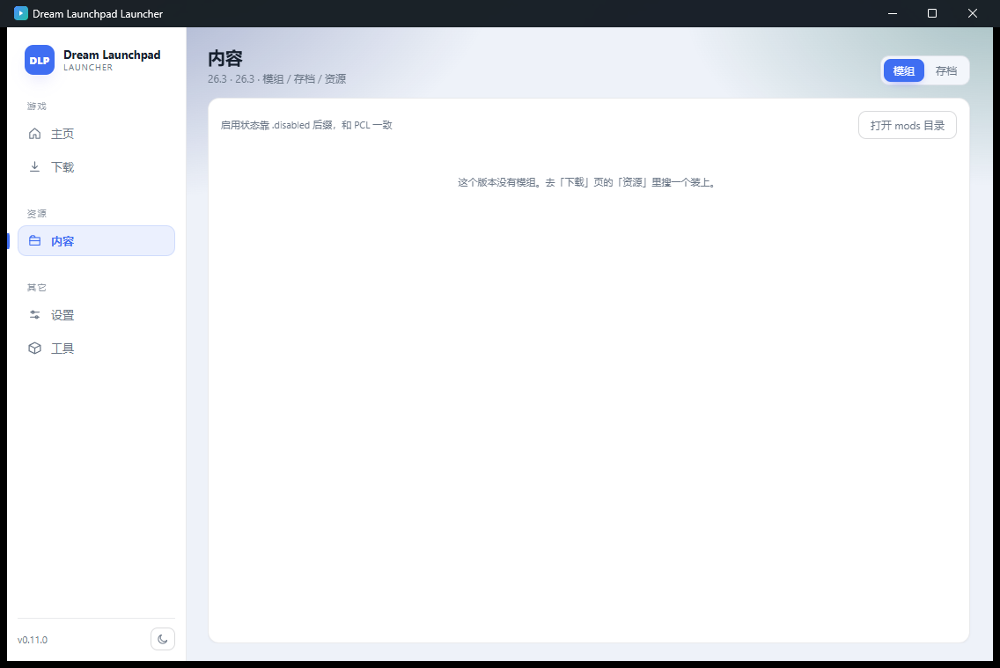
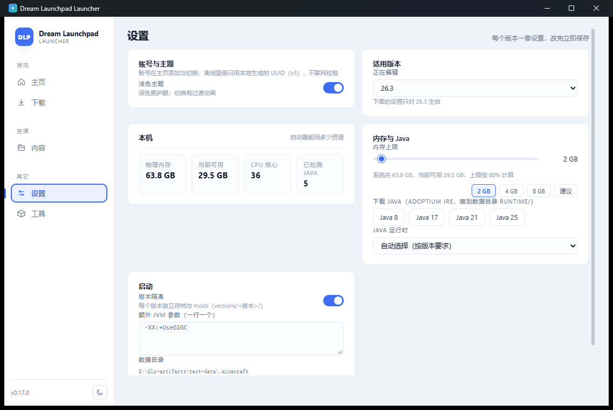
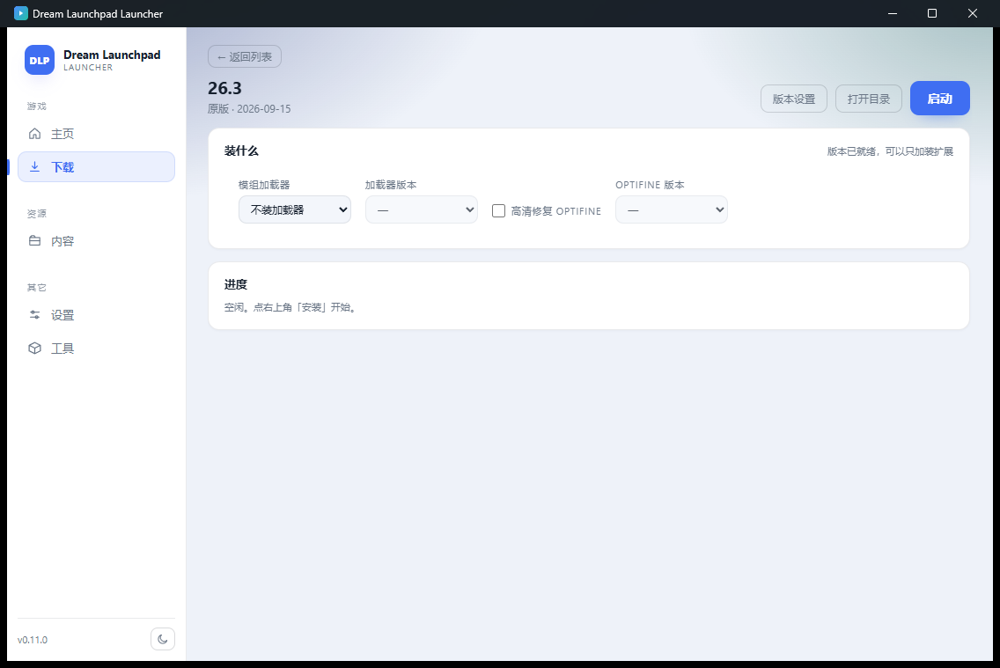

# Dream Launchpad Launcher

从零设计的 Minecraft: Java Edition 启动器（代号 **DLP**）。

- 核心：Rust（`dlp-core`，无 GUI 依赖，可单测）
- 桌面壳：[Tauri 2](https://tauri.app/)
- 界面：React 19 + Vite + TypeScript

## 仓库与产物的边界

这个仓库**只放源码**，构建产物和测试数据都不进来：

| 位置 | 放什么 |
| --- | --- |
| `D:\mcqdq`（本仓库） | 源码 + 文档；`dist/`、`node_modules/`、`target/` 均被忽略 |
| `D:\dlp-artifacts\release\<版本>\` | 打包产物：`DreamLaunchpad.exe` + `WebView2Loader.dll`、NSIS 安装包、便携 zip |
| `D:\dlp-artifacts\test-data\.minecraft` | 本机测试用的游戏目录（`DLP_HOME` 指向这里） |

分支语义也要分清：

- `main` —— .NET 版（历史实现，已停更）
- `feat/rust-tauri` —— Rust + Tauri 重写版，也就是现在这个产品


## 当前功能（1.0.0）

### 主页
选版本、看账号、一键启动；已安装版本按加载器打标签（原版 / fabric / forge / quilt / optifine），
DLP 装的版本额外标一个 **DLP** 徽章；玩过的版本卡片上带「· 2 小时前」，并按最近启动排序，
顶部大卡片也会写「上次玩 2 小时前」。左下角显示版本号，右下角切主题。

### 下载
版本清单按主版本分组，支持「正式版 / 快照 / 远古版 / 已安装 / 本地 / 最近玩过」六种筛选 + 关键词搜索。
点进版本详情后：

- **装什么**：加载器用卡片挑（原版 / Fabric / Quilt / Forge / NeoForge），选完再从下拉里挑加载器版本；
  OptiFine 单独一栏。装过之后还能只加装扩展
- **整合包**：`.mrpack`、CurseForge zip、MultiMC/Prism、HMCL、纯覆盖包都能装；也能把版本导出成 `.mrpack`

### 市场
Modrinth 与 CurseForge 两个来源，模组 / 材质 / 光影 / **整合包** 四类，可按游戏版本、加载器、类别筛选。

整合包在列表页的按钮是「选择」而不是「安装」—— 一个整合包有几十个文件（不同 MC 版本各一份），
得进详情挑具体版本。选完下载 zip，再按格式（mrpack / CurseForge / MultiMC / HMCL / 覆盖包）
解成一个**新版本**，不动现有版本。

CurseForge 需要自己申请 API key（免费，console.curseforge.com）。填进设置页之后可以点
「测一下这个 key」当场验证 —— 403 是 key 本身的问题（重新生成，等一两分钟生效），
429 是当天配额用完，两种情况处理方式完全不同，所以分开提示。

> 为什么别的启动器（比如 PCL2）不用填 key：它们把自己申请的 key 编进了程序里。
> 那是人家的配额，你用得越多它凉得越快；这里没跟着做。Modrinth 不需要 key，
> 整合包也有近两万个，够用。

### 版本设置（每个版本一份）
概况、修改（改内存/Java/隔离）、模组、存档、服务器、皮肤、截图、游戏内设置、资源包、光影。

- **模组**：启停、批量、删除；点文件名看内部 id / 版本 / 作者 / 依赖 / 描述；
  「可以更新」按文件 SHA1 问 Modrinth；「装了多个版本」列出重复的模组 id
- **存档**：列表、备份成 zip、还原、导入外部 zip、展开看种子/模式/难度/存档版本
- **服务器**：读写 `servers.dat`；「查在线状态」显示人数/MOTD/延迟；「直连」直接进服
- **游戏内**：渲染距离、模拟距离、帧率、视场角、亮度、画质、粒子、界面缩放、语言、全屏
- **资源包**：勾选启用（写进 `options.txt` 的 `resourcePacks`）

### 全局设置
本机信息、下载源（镜像优先 / 官方直连）、CurseForge key（带「测一下」按钮）、主题、
全局内存与 Java、Java 下载（Adoptium JRE 8/17/21/25）、数据目录。

### 工具
目录入口、日志查看、崩溃报告、环境信息。

### 其它能力

- 微软正版登录（设备码：申请到就复制到剪贴板并拉起浏览器）与离线账号
- 自动探测 Java、按版本要求挑；也能下载 JRE
- 启动失败诊断：非正常退出时读日志与崩溃报告，给出结论与建议
- JVM 参数预设（Aikar's flags / 低配机）
- 下载走 BMCLAPI 镜像，失败回退官方；便携模式（exe 同目录 `.minecraft`）
- 启动器自身更新检查（查 GitHub Releases）

## 界面

扁平化：浅色为主（深色可一键切换，侧栏底部有开关），实色 + 1px 细线 + 8px 圆角，不用渐变和投影。

| 主页 | 下载 |
| --- | --- |
|  |  |

| 资源搜索 | 内容 |
| --- | --- |
|  |  |

| 设置 | 版本详情 |
| --- | --- |
|  |  |

- **版本设置**：单个版本的内存 / Java / 版本隔离 / JVM 参数 + 该版本的模组管理（`versions/<版本>/mods`）

能力：

- 扫描 `versions/` 下所有版本（含别的启动器装的），本地版本标「本地」
- 原版安装（客户端 jar / 依赖库 / natives / 资源），SHA1 校验、16–32 并发，>4MB 文件分片多连接
- 离线登录（UUID v3），自动挑选合适的 Java
- 版本隔离（默认开）与游戏默认中文（`lang:zh_cn`）
- 下载走 BMCLAPI 镜像，失败回退官方；便携模式（exe 同目录 `.minecraft`）
## 目标平台

| 平台 | 状态 |
| --- | --- |
| Windows 10 1809+ (x64) | 主要目标 |
| Linux x86_64 | 主要目标 |
| Linux arm64 | 主要目标（游戏本体在 arm64 上的可运行性待实测） |
| Windows 7 | **不做**（见 [REQ-001](docs/requirements/REQ-001-启动器骨架.md) §4） |
| macOS | 本期不做 |

## 数据目录

默认是**可执行文件同目录的 `.minecraft`**（绿色版，拷走整个文件夹就能带走存档）。
如果那个目录不可写（装在 Program Files 之类），自动退回 `%APPDATA%\DreamLaunchpad`。
用环境变量 `DLP_HOME` 可以指定任意目录。

下载默认走 [BMCLAPI](https://bmclapidoc.bangbang93.com/)：清单、客户端 jar、依赖库、资源对象优先镜像，
失败自动回退官方源。

## 结构

```
Cargo.toml          # Rust workspace
src/                # dlp-core：核心逻辑（清单 / 下载 / 校验 / Java / 启动 / 账号）
src-tauri/          # Tauri 壳：窗口、命令、打包配置、图标
ui/                 # React 19 前端源码：pages/（四个页面）+ components/ + store.ts（构建产物输出到根目录 dist/）
docs/               # 需求、调研、设计
scripts/            # 开发辅助脚本（图标生成等）
```

## 本地开发

```bash
npm install                 # 前端依赖
npm run tauri dev           # 起开发环境（Vite + Tauri 窗口）
npm run build               # 只构建前端
cargo test -p dlp-core      # 核心库单测
npm run tauri build         # 打包安装包（Windows: NSIS）
```

### 本机（Windows + MinGW）注意事项

这台机器没有 MSVC，Rust 走 `x86_64-pc-windows-gnu`，编译前需要：

```powershell
$env:CARGO_HOME='D:\rust\cargo'; $env:RUSTUP_HOME='D:\rust\rustup'
$env:RUSTC='D:\rust\bin2\rustc.exe'; $env:RUSTDOC='D:\rust\bin2\rustdoc.exe'
$env:PATH="D:\toolchain\mingw64\bin;D:\toolchain\nasm\nasm-2.16.03;$env:PATH"
```

- **项目路径必须是纯 ASCII**：MinGW 的 `ld.exe` / `windres.exe` 不认中文路径
- `ring`（rustls 依赖）需要 NASM
- `[lib] crate-type` 不能含 `cdylib`，否则 Windows 导出序号溢出

## 文档

- [REQ-001 启动器骨架](docs/requirements/REQ-001-启动器骨架.md)
- [C 语言 GUI 框架调研](docs/research/C-GUI框架调研.md)
- [PCL / PCL-CE 参考调研](docs/PCL-参考仓库调研.md)
- [上一版 .NET 设计（已归档）](docs/legacy/设计-DotNet版.md)
